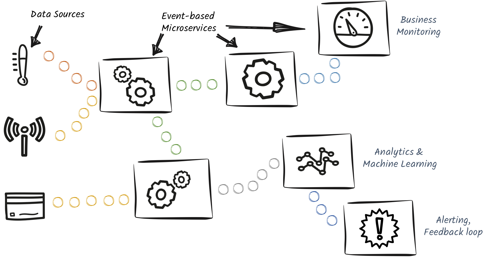

= SmallRye Reactive Messaging
include::_attributes.adoc[]

*SmallRye Reactive Messaging is a framework for building event-driven, data streaming, and event-sourcing applications.*

It lets your application interact using various messaging technologies such as Apache Kafka, AMQP or MQTT.
The framework provides a flexible programming model bridging https://www.cdi-spec.org/[CDI] and event-driven.

SmallRye Reactive Messaging is an implementation of the Eclipse MicroProfile Reactive Messaging specification {spec-version}.

.Event-Driven Architectures

SmallRye Reactive Messaging is used in http://quarkus.io[Quarkus], and https://openliberty.io/[Open Liberty].

Start with the xref:getting-started.adoc[Getting Started] guide to know how it can be used and introduce various features.
